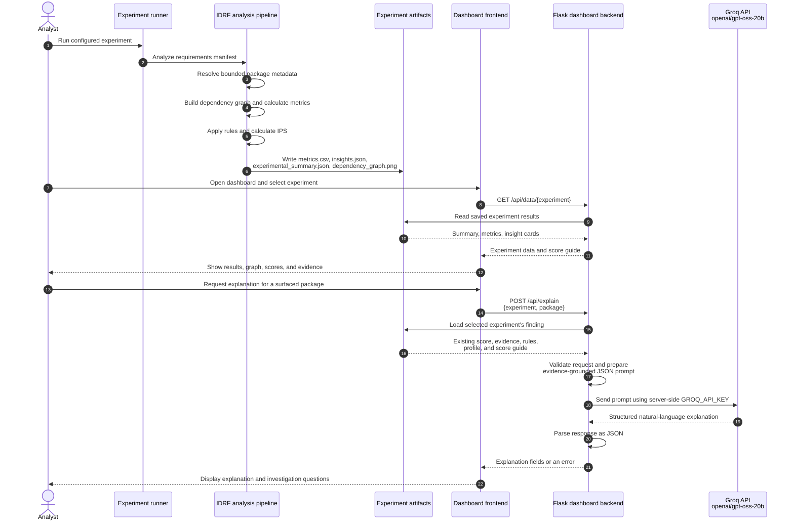

# IDRF Component Interaction

The diagram shows how IDRF's analytical pipeline produces evidence for the
dashboard and how the optional Groq explanation endpoint uses an existing
finding. Groq is an explanation layer; the core analysis and Investigative
Priority Score (IPS) are calculated before any AI request.

The explanation endpoint does not recalculate or change analysis results. Its
response describes the supplied evidence and should be checked against the
original finding. If the API key is missing, the request fails, or Groq returns
an unusable response, the dashboard's evidence-based results remain available.

## 3.6 Dashboard API Endpoints

The Flask backend exposes the endpoints below for experiment discovery, saved
analysis results, graph-image delivery, and optional AI assistance. The methods,
request fields, and responses shown here reflect the current routes in
`dashboard_server.py`.

**Table 3.1: Main Dashboard API Endpoints**

| Endpoint | Method | Purpose and request | Response | Error behavior |
|---|---|---|---|---|
| `/api/experiments` | `GET` | Lists experiments with a saved `metrics.csv`, for populating the dashboard selector and comparison table. | JSON array. Each item includes `experiment`, `packages_analyzed`, `cards_generated`, `mean_depth`, and `max_score`. | Returns an empty array when no matching experiment artifacts are present. |
| `/api/data/<experiment>` | `GET` | Retrieves one experiment's saved analysis data. | JSON object with `experiment`, `summary`, `packages`, `cards`, `graph` (the graph-image URL), and `score_guide`. | `404` if the experiment artifacts are not found. |
| `/api/graph/<experiment>` | `GET` | Delivers the saved dependency-graph image. This endpoint returns an image, not graph data in JSON form. | The experiment's `dependency_graph.png` file. | `404` if the graph image is unavailable. |
| `/api/explain` | `POST` | Accepts JSON containing `experiment` and a surfaced `package`. The backend obtains that package's existing finding and sends its evidence, score guide, triggered rules, and profile to Groq. | JSON object containing `explanation` with `summary`, `evidence_interpretation`, `why_it_matters`, `investigation_questions`, and `limitations`. | `400` for missing or invalid fields; `404` if artifacts or the surfaced package are unavailable; `503` if `GROQ_API_KEY` is missing; upstream API errors may be returned with their status; network or unexpected-response errors return `502`. |
| `/api/chat` | `POST` | Accepts JSON containing `experiment` and a non-empty `messages` array with `user` or `assistant` roles. The backend sends the conversation and selected experiment context to Groq. | JSON object containing an `answer` string. | `400` for invalid or overlong conversations; `404` if experiment artifacts are unavailable; `503` if `GROQ_API_KEY` is missing; upstream API errors may be returned with their status; network or unexpected-response errors return `502`. |

The endpoints provide separate operations for experiment discovery, result
retrieval, graph-image delivery, package explanation, and conversational
assistance. `/api/explain` connects a surfaced analytical finding to a
natural-language explanation; it does not recalculate or modify the
Investigative Priority Score (IPS). Both AI endpoints use the configured Groq
model `openai/gpt-oss-20b`. The Groq API key is read by the backend from
`GROQ_API_KEY` and is not included in requests from the frontend.
